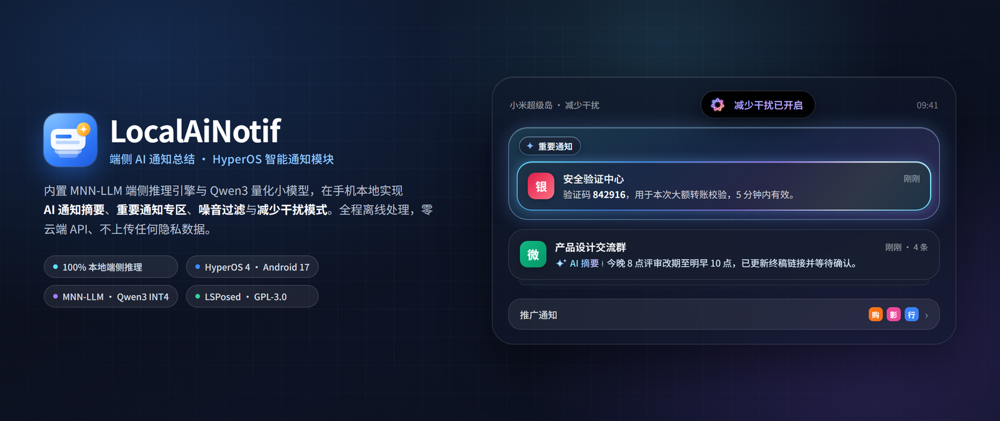
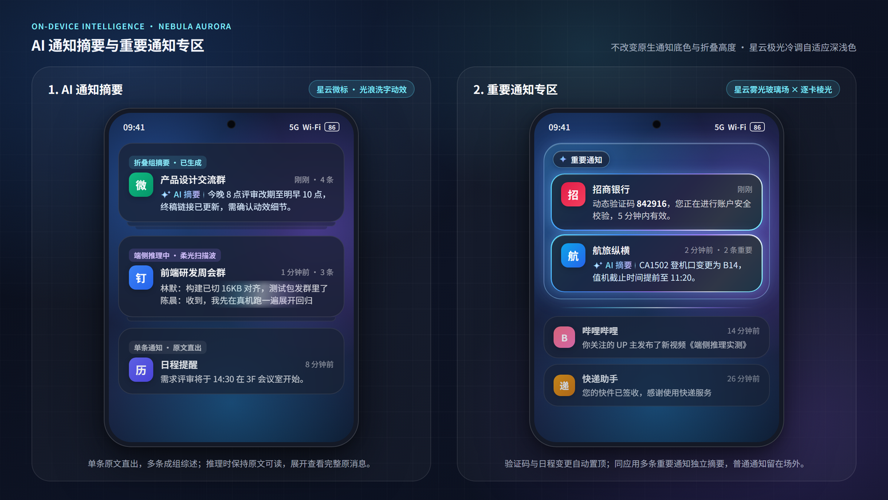
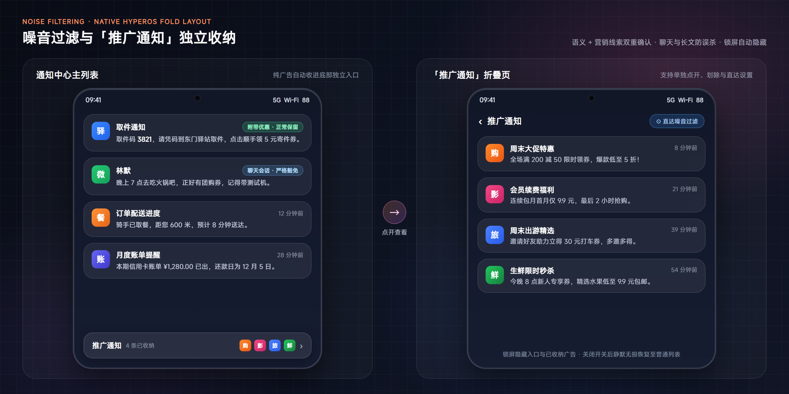
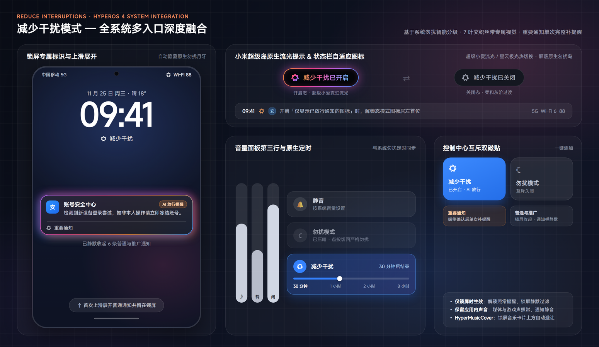
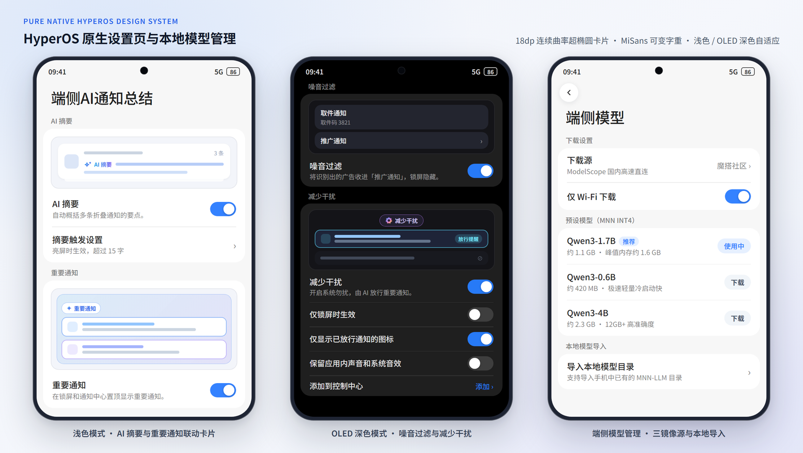

<p align="center">
  
</p>

# LocalAiNotif For HyperOS

> 本地端大模型驱动的 HyperOS 智能通知模块（LSPosed · 100% 离线端侧推理）

**LocalAiNotif For HyperOS** 是一款面向小米澎湃 OS（HyperOS）的开源 LSPosed 模块。模块内置 [MNN-LLM](https://github.com/alibaba/MNN) 端侧推理引擎，在设备本地运行 **Qwen3.5** 量化模型，按 **Hexagon NPU → Vulkan GPU → CPU** 自动选择并回退推理后端。模块为系统通知中心、锁屏、状态栏、音量面板与小米超级岛带来 **AI 通知摘要**、**单条长通知 AI 概括**、**重要通知专区**、**噪音过滤** 与 **减少干扰模式**。所有通知文本均在手机本地完成处理，**无需云端 API、不上传任何隐私数据、不依赖小米云控或小米账号**。

---

## 环境要求与兼容性说明

> [!IMPORTANT]
> - **系统兼容性**：当前实测环境为 **HyperOS 4 / Android 17**（主力机型：小米 15），**不保证更低版本系统或非 HyperOS 4 设备的兼容性**。

| 项目 | 要求 / 说明 |
|---|---|
| 测试环境 | **HyperOS 4 / Android 17**（小米 15），`minSdkVersion = 34` / `targetSdkVersion = 36` |
| 权限框架 | Root + **LSPosed**（`libxposed` API 102，静态作用域） |
| 芯片架构 | ARM64 (`arm64-v8a`)，原生支持 Android 15+ 16KB 页对齐 |
| 推理后端 | 自动按 **高通 Hexagon NPU**（内置 `v73 / v75 / v79 / v81 / v83 / v85` 六代 DSP 算子库，覆盖骁龙 8 Gen 2 / 8 Gen 3 / 8 至尊版 / 第五代骁龙 8 至尊版及新一代平台，详见下方对照表）→ **Vulkan GPU** → **CPU** 依次选择与回退。Vulkan GPU 加速取决于设备驱动，可用于骁龙、天玑、玄戒等平台。 |

> 模块深度对接 HyperOS 4 原生通知框架（`HyperNotificationManagerService`、`MiuiSystemUI`、音量面板插件、小米超级岛、`MIUINotificationCenter` 与系统设置）。若在未测试系统版本中遇到不匹配的 Hook 符号，对应特性会自动安全降级，不会导致系统崩溃，但部分视觉或交互能力可能不可用。

### 第三方模块兼容（HyperMusicCover）

**与 [HyperMusicCover](https://github.com/zyl6932/HyperMusicCover) 联用**（按 `v0.9.60` 适配）：两个模块同时在 LSPosed 的系统界面（`com.android.systemui`）作用域生效后，开启「减少干扰」时会联动收起锁屏超级岛内的普通通知。系统允许在锁屏展示的重要通知、来电与导航照常保留，在锁屏空白处上滑即可临时展开已静默的普通通知（自动避让媒体控制卡片区域）。

锁屏音乐卡片显示时，「减少干扰」标识会自动上移避让至卡片上方；音乐卡片收起后自动回到锁屏时钟下方。播放控制与封面手势仍交由音乐封面模块处理，基于 `MediaSession` 的自定义播放器通知也可正常放行；模式开启期间会自动隐藏日期旁的原生勿扰月牙图标。

---

## 核心功能

> [!NOTE]
> 以下配图基于默认**「超级小爱流光」**主题绘制，实际渲染效果随所选光效风格（支持热切「星云极光」）、系统深浅色与壁纸材质实时自适应。

### 1. AI 摘要（折叠组多条汇总）
- **自然连贯第三人称摘要**：所有通知先按系统流程即时投递原文；同一应用的多条通知折叠成组后，由端侧模型在后台生成 Apple Intelligence 式 **1–2 句自然连贯的第三人称汇总**（保留发件人、关键动作及取件码/验证码/时间/金额/地点，保持原文语言）。
- **富样式上下文与确定性尾注**：完整提取 `MessagingStyle` 多轮聊天记录（最新 4 轮、优先取会话标题防重复发件人）与 `InboxStyle` 多行列表，单次喂入最新 8 条并按时间正序整理；当组内通知超出喂入窗口或涉及多发件人时，由程序确定性补齐柔和余量尾注（如「等共 N 条通知」），不让小模型心算。
- **宁缺毋滥护栏**：前置校验本地模型就绪状态（无模型零扫光、零请求），彻底去除规则截断假摘要兜底；内置护栏拦截空输出、提示词泄漏、复读循环、照抄原文及丢失/篡改显式验证码或取件码，命中即静默保留原生折叠原文。
- **内联流光微标、自适应高度与 4 阶段动效**：不改动卡片底色与外框，折叠预览行首绘制自绘**双四角星芒 `✦✦ AI 摘要 |`** 与轻混流光正文，折叠卡片按实际排版高度自适应伸缩（上限 **4 行**，避免截断）。完整覆盖：① 真实 `inFlight` 推理期 `14°` 倾斜扫光波（`140ms` 防抖，原文全程可读）；② 首次落地/更新 `880ms` 光浪洗字与双星芒轻绽；③ 亮屏/下拉重入 `550ms` 徽标微光；④ 展开/折叠跟手微缩放与 `350ms` 折回轻闪（遵循锁屏隐私隐藏、息屏零动画与系统减弱动效）。
- **灵活触发设置（二级页「摘要触发设置」）**：默认开启且对全部应用生效，支持即时调节**亮屏时生成摘要**（默认开启）、**合并等待时间**（`0 / 5 / 15 / 30 / 60 秒`，默认 `0 秒`）、**最小触发数量**（`1 / 2 / 3 / 5 条`，默认 `1 条`）与**最小字数门槛**（`0 / 10 / 15 / 30 / 50 字`，默认 `15 字`，重要通知不受限制），修改后无需重启立即同步。
- **无残留虚拟启用**：运行时在内存中接管 HyperOS 原生 AI 通知状态，不向系统写入 `ai_notification_setting`，停用或卸载模块后不污染系统设置。

### 2. AI 概括（单条长通知要点提炼）
- **面向单条长消息**：首页独立成节（默认关闭），开启后自动将单条较长通知提炼为 **1–2 句凝练要点**（优先呈现最新安排或结果及下一步行动，保留时间、地点与验证码，省去寒暄和旧信息），覆盖独立单条通知以及展开通知组后的长消息子卡；折叠组仍继续显示整组「AI 摘要」。
- **单星芒流光视觉与 4 阶段动效**：与「AI 摘要」同源流光但视觉一眼可辨——行首采用**单颗四角星芒 `✦ AI 概括 |`** + 渐变半粗体微标 + `0.8dp` 渐隐竖光丝与轻混正文，严格维持单条通知原生行数、卡片高度与原生底色/外框。完整对齐 4 阶段光学动效（推理中 `14°` 倾斜扫光波 → 当前视野实时落地 `880ms` 光浪洗字 → 重入视野与展开通知组首次露出后台已算好长消息时仅播 `550ms` 徽标微光 → 单卡收起回概括态播 `350ms` 轻闪）。
- **原文无损与原生交互**：顶部弹出横幅（Heads-up）保持原生原文不概括；锁屏是否展示概括遵循系统通知隐私设置；点开/展开该条通知即可完整阅读原文，通知中心与锁屏的所有长按操作均 100% 沿用小米原生行为。
- **内联独立配置与即时重判**：独立卡片内配备专属 `RecapPreviewView` 动态示意图，并常驻内联提供：
  - **亮屏时概括**（默认开启）：关闭后仅在息屏时生成新概括，亮屏到达的新长通知保持原文并在息屏后自动补齐，已生成的概括不撤销。
  - **触发字数门槛**（4 档底部浮窗：`50 字` / `80 字（默认）` / `120 字` / `200 字`）：按汉字数计，英文字母与数字按约 2 字符折 1 字；修改门槛后立即对通知栏现有通知重判生效（调低门槛即时补算达标通知，调高门槛自动撤销不再达标的旧概括）。

### 3. 重要通知专区
- **纯端侧语义判定**：默认开启，由本地大模型实时识别**验证码、支付与交易、账号安全告警、物流异常、日程变更、健康告警、家人未接来电**等高优先级消息。
- **Apple 智能连续合卡 × 双光效环绕柔光**：在锁屏与通知中心自动置顶重要通知。通知中心内多条重要通知无缝合并为一张连续整卡（内分割线分隔各条）并在最底端共用同一个 7 叶交织丝带「重要通知」Footer；整卡外沿由 AGSL 着色器绘制柔和多色外扩散光晕与贴边玻璃折射棱，卡片内部文字与分割线 100% 清透；亮屏、下拉或新重要通知置顶时外沿流光丝滑流转约 `1.6s` 后静息。锁屏顺应 HyperOS 原生堆叠，顶部横幅保持原生清爽不加 Footer。
- **解锁下拉刻意分层入场**：解锁态下拉通知中心且存在重要通知时，重要通知原生先行进入，下方普通通知在拖拽初段静默留白，跨过阈值或松手时原地柔和淡入微落，消除原生下拉跳动与穿透感。
- **独立 VIP 分组与专属摘要**：同一应用有 2 条及以上重要通知时，自动聚合为独立原生折叠组并仅基于组内 VIP 生成专属 AI 摘要，不与同应用的普通通知混杂；缩减回单条时自动恢复单卡。

<p align="center">
  
</p>

### 4. 噪音过滤（广告推广收纳）
- **原样即时提醒，后台精准收纳**：首页独立开关（默认关闭，适合长期开启）。通知到达时先按系统原设置即时提醒，随后由端侧模型在后台独立判定（不受摘要等待时间与字数门槛限制）；未就绪模型或异常时保持原通知不变。
- **纯端侧语义自主判定**：以单条通知的主要用途为判据，由本地大模型结合提示词直接理解内容语义并独立分类，不叠加硬编码关键词/正则兜底或类别白名单覆盖；取件码、订单物流、账单、日程、聊天与新闻订阅即使正文附带优惠或领券尾巴，也会引导模型按主要用途保留。
- **原生「推广通知」折叠页与无损恢复**：解锁后在通知中心底部沿用 HyperOS 原生「更多通知」样式展示独立「推广通知」入口与应用图标条，锁屏隐藏入口及已收纳广告。点开后可逐条查看、跳转原应用或单独划掉；右上角设置图标直达模块「噪音过滤」栏目，手动关闭开关时仍有效的已收纳通知会静默恢复至普通列表。

<p align="center">
  
</p>

### 5. 减少干扰模式（Reduce Interruptions）
- **智能分级勿扰**：默认关闭，复刻 iOS 18「减少干扰」体验，基于系统勿扰（`ZenMode`）构建并完整继承系统勿扰原生例外（来电、重复来电、闹钟、进行中事件）：
  - **普通与推广通知**：在通知中心静默保留、锁屏时默认收起；锁屏上滑一次即可临时展开查看并停留，重新锁屏或息屏后再次收起。
  - **重要通知穿透补发**：新通知到达后立即跳过摘要等待与字数门槛执行端侧分类，确认为重要通知（`important && vip`）后单次完整补发提醒（声震 / 横幅 / 亮屏）；无模型或超时时按 fail-closed 保持安静。
- **全系统多入口深度融合（7 叶交织丝带图标）**：
  - **锁屏标识**：在锁屏时钟下方显示单色白色 7 叶丝带与「减少干扰」，开启期间自动隐藏锁屏原生勿扰月牙。
  - **控制中心互斥磁贴**：支持在设置页一键添加「减少干扰」快捷磁贴，与系统原生「勿扰模式」磁贴严格互斥。
  - **音量面板第三行与原生定时**：在 HyperOS 展开音量面板的「勿扰模式」行下方新增「减少干扰」独立行与原生滑动定时条，倒计时与系统勿扰定时完全同步，点击原生「勿扰模式」可一键切回传统严格勿扰。
  - **小米超级岛专属流光卡片**：开启时调用 HyperOS 4 超级岛原生 SDF 流光边框并施加 AGSL 渐彩扫光文字（支持「超级小爱流光」与「星云极光」联动），关闭态保持素雅银灰，并屏蔽原生勿扰岛防止覆盖。
  - **状态栏自适应图标**：状态栏自动显示单色交织丝带矢量图标，自适应深浅色状态栏。
- **三项常驻精细开关（默认均关闭）**：
  - **仅锁屏时生效**：亮屏解锁使用手机时恢复正常提醒，息屏或锁屏时自动拦截打扰。
  - **仅显示已放行通知的图标**：隐藏状态栏左侧未放行通知的应用图标，仅展示例外与 AI 放行通知；开启后解锁态模式图标移至左侧首位，锁屏态居于右侧。
  - **保留应用内声音和系统音效**：音乐、游戏和触摸音效按手机原设置正常播放；普通通知保持静音，仅重要通知放行后可按原渠道响铃。

<p align="center">
  
</p>

### 6. 双光效风格、本地模型与 HyperOS 原生设置
- **双「光效风格」无重启热切换**：在首页「其他 › 光效风格」可在 **超级小爱流光（默认，暖橙/玫粉/薰衣草紫/电光蓝）** 与 **星云极光（天青/晴空蓝/冰紫）** 间一键切换，实时广播同步至通知栏全部 AI 视觉（AI 摘要、AI 概括、重要通知合卡、减少干扰超级岛）及设置页全部 **5 组动态示意图**。
- **三层异构推理与自动回退**：内置高通 Hexagon 六代 DSP 算子库（`v73 / v75 / v79 / v81 / v83 / v85`，对应骁龙 8 Gen 2 至第五代骁龙 8 至尊版及新一代骁龙平台）与 Vulkan GPU 支持，运行时通过 FastRPC 自动探测 DSP 架构并按 **Hexagon NPU → Vulkan GPU → CPU** 依次探测与推理；初始化失败、生成报错、超时或返回空结果时自动释放并切换至下一后端重试当前请求，所有后端共用同一份 MNN INT4 权重。
- **多镜像源一键下载与本地导入**：内置 **魔搭社区 ModelScope（默认推荐）**、**HF-Mirror** 与 **Hugging Face** 三下载源，支持断点续传、仅 Wi-Fi 下载保护（默认开启）与前台服务进度通知；同时支持通过系统目录选择器导入手机上已有的 MNN-LLM 模型目录，查看详情与原目录位置，删除导入模型时仅移除模块内部副本，不动原文件夹。
- **独立隔离进程与内存策略**：推理引擎运行在独立 `:inference` 进程，不占用 `system_server` 内存，内置 MIUI 墓碑冻结（`GreezeManager`）重试保护；默认按需懒加载并在空闲 **3 分钟** 无推理后自动卸载释放内存，同时提供**始终加载 AI 模型**开关（由 `system_server` 静默绑定 `ModelKeepAliveService`，通知到达免冷启动）。
- **HyperOS 原生设置与「关于」页**：全页采用纯原生 Java View 实现 HyperOS 4 视觉规范（`18dp` 连续曲率超椭圆卡片、`28dp` 左对齐基准线、MiSans 可变字重、自绘阻尼胶囊开关、**5 组实时联动功能示意图**，自适应浅色与 OLED 纯黑深色模式）。「关于」页支持：
  - **在系统设置中显示入口**（默认关闭）：实时在「系统设置 › 通知与状态栏」的「小米超级岛」同卡下方融合注入入口，无需重启。
  - **隐藏桌面图标**：通过 `<activity-alias>` 实现并附带防迷路确认引导，保留系统设置与 LSPosed 管理器入口。
  - **应用内检查更新**：一键查询 GitHub 最新正式版，通过系统 `DownloadManager` 下载对应 `LocalAiNotif-v<version>.apk` 至系统「下载」目录。
  - **运行环境诊断**：双轨核验 LSPosed 自注入状态与 `system_server` 实时版本（自动区分「已激活」与「需软重启」），查看设备/模型/引擎状态并一键复制诊断信息。

<p align="center">
  
</p>

---

## 快速上手

### 第一步：安装与激活模块
1. 前往 [Releases](https://github.com/InternetBugs/LocalAiNotif-For-HyperOS/releases) 下载最新正式版安装包（不含模型权重，体积轻巧）：
   - `LocalAiNotif-v<version>.apk`（**Release**）：关闭应用调试，推荐日常使用。
   - `LocalAiNotif-v<version>-debug.apk`（**Debug**）：开启调试模式，适合排查问题或通过已授权的 ADB 使用 `run-as`。
   - 两个包功能、包名和正式签名完全一致，任选其一安装即可。
2. 打开 **LSPosed 管理器**，启用 **端侧AI通知总结 For HyperOS（LocalAiNotif For HyperOS）**，确认以下 **5 个静态作用域**（见 [scope.list](META-INF/xposed/scope.list)）已勾选：
   - **系统框架** (`system`)
   - **系统界面** (`com.android.systemui`)
   - **通知管理 / 通知中心** (`com.miui.notification`)
   - **设置** (`com.android.settings`)
   - **端侧AI通知总结 For HyperOS** (`io.github.internetbugs.localainotif`，用于「关于」页读取框架信息与激活状态)
3. **软重启或重启手机**使 Hook 生效（更新版本后若涉及系统 Hook 变更，软重启一次即可）。

### 第二步：下载或导入本地模型
1. 打开 **端侧AI通知总结 For HyperOS**，进入「本地模型 › 端侧模型」。
2. 选择下载源（国内网络推荐默认的**魔搭社区 ModelScope** 或 **HF-Mirror**）。
3. 下载预设模型 **Qwen3.5-0.8B（推荐）** 或 **Qwen3.5-2B** 并设为当前模型；也可以直接导入手机本地已有的 MNN-LLM 模型目录。

#### 预设端侧模型与实测资源占用

| 模型（MNN INT4） | 下载大小 | 推理后端 | 推理进程峰值内存 | 短通知摘要耗时 |
|---|---:|---|---:|---:|
| **Qwen3.5-0.8B（推荐）** | 约 550 MB | CPU | 924 MiB | 0.36 秒 |
| **Qwen3.5-0.8B（推荐）** | 同一份模型 | Vulkan GPU | 1,020 MiB | 0.68 秒 |
| **Qwen3.5-0.8B（推荐）** | 同一份模型 | Hexagon NPU + CPU | 299 MiB | 0.99 秒 |
| **Qwen3.5-2B** | 约 1.27 GB | CPU | 1,725 MiB | 0.73 秒 |
| **Qwen3.5-2B** | 同一份模型 | Vulkan GPU | 2,208 MiB | 2.72 秒 |
| **Qwen3.5-2B** | 同一份模型 | Hexagon NPU + CPU | 1,343 MiB | 4.99 秒 |

> 数据来自小米 15（骁龙 8 至尊版 `SM8750`）实测，每种后端独立运行三次取中位数。内存为完成短通知摘要与分类期间的进程峰值 RSS。CPU 和 NPU 数据来自 `:inference` 进程，Vulkan 数据来自加载同一应用推理引擎的独立测试进程。GPU 和 NPU 专用内存未单独计量。耗时为同一条会议通知生成一句摘要的时间，不含模型加载、回退重试或排队耗时。

两款预设模型的权重在所有后端间共用。引擎通过 FastRPC 查询高通 DSP 的实际架构，自动加载匹配的算子库（要求设备具备 FP16 HMX 且应用可访问 CDSP）：

| Hexagon DSP 架构 | 对应常见高通骁龙 SoC（供参考） | 说明 |
|---|---|---|
| **`v73`** | 骁龙 8 Gen 2（`SM8550`）、骁龙 8s Gen 3（`SM8635`）、骁龙 7+ Gen 3（`SM7675`）、骁龙 8s Gen 4（`SM8735`） | 已编译并核对 ELF，是否启用取决于设备 FP16 HMX 与 ROM CDSP 权限 |
| **`v75`** | 骁龙 8 Gen 3（`SM8650`） | 已编译并核对 ELF，待实机验证 |
| **`v79`** | 骁龙 8 至尊版（`SM8750`） | **小米 15 已实测**：NPU 承担投影运算（2B 额外使用 NPU 做门控归一化），其余算子由 CPU 协作 |
| **`v81`** | 第五代骁龙 8 至尊版（`SM8850`）、第五代骁龙 8（`SM8845`） | 已编译并核对 ELF，待实机验证 |
| **`v83` / `v85`** | 新一代 / 后续高通骁龙旗舰平台（Hexagon SDK 6.7 目标，面向搭载 `v83 / v85` cDSP 的 `SM8950` 等后续机型） | 已预编译并核对 ELF，实际覆盖取决于芯片与 ROM |

> 上表按高通 QNN / QAIRT 及 Hexagon SDK 架构资料整理；运行时完全以设备 FastRPC 返回的实际 DSP 架构号为准，不做机型白名单硬编码。部分衍生芯片虽同属 `v73` 架构，若固件未开放 FP16 HMX 或 CDSP 访问权限，会自动回退至 Vulkan GPU / CPU。

NPU 不可用时，引擎尝试 Vulkan，最后回退到 CPU。初始化失败、生成报错、超时或返回空结果时会释放当前引擎，在下一个可用后端重试同一条请求。后续请求沿用成功的后端，直至模型卸载。手动导入模型可在 `config.json` 中省略 `backend_type` 或设置为 `"auto"`（及 `"hexagon"`）以使用完整顺序，也可指定 `"vulkan"`（失败后回退 CPU）或 `"cpu"`。GPU 路径的耗时、功耗和内存需按设备实测。

APK 已内置 `libs/hexagon/` 中的一份 Android FastRPC 接口库与各架构的 DSP 算子库。Linux 重编时，设置 `MNN_DIR` 为发版流程锁定的 MNN 源码、`HEXAGON_SDK_ROOT` 为 SDK 根目录。SDK 6.4.0.2 可执行 `bash tools/hexagon/build-ops.sh v73 v75 v79 v81`；v83 和 v85 使用 SDK 6.7.0.0 及其 `HEXAGON_TOOLS_ROOT=…/tools/HEXAGON_Tools/21.0.04`，执行 `bash tools/hexagon/build-ops.sh v83 v85`。设置 `ANDROID_NDK_HOME`（r28c）可同时重编 Android 接口库。`python3 tools/hexagon/verify.py <APK>` 可验证包内全部 DSP 架构。

### 第三步：按需调整功能与入口
- **AI 摘要 / 重要通知**：默认开启并对全部应用生效，可在首页一键开关或进入「摘要触发设置」调整触发参数。
- **AI 概括**：默认关闭，在首页独立「AI 概括」栏目开启后，可随时调节「亮屏时概括」与「触发字数门槛（50 / 80 / 120 / 200 字）」。
- **噪音过滤**：默认关闭，开启后自动在后台将纯广告收纳至通知中心底部的「推广通知」。
- **减少干扰**：可在首页开启、点击「添加到控制中心」添加快捷磁贴，或在展开的 HyperOS 音量面板第三行直接开关并拖动定时。
- **光效风格 / 系统设置入口 / 隐藏桌面图标 / 检查更新**：在首页底部「其他」切换光效风格，或进入「关于」页按需配置入口与核验运行环境。

---

## 隐私与安全

- **100% 本地离线推理**：所有通知分类、折叠组摘要与单条概括均通过内置 MNN-LLM 引擎在设备本地完成，通知原文绝不离开本机。
- **极简按需联网**：仅在你手动下载预设模型时访问所选模型仓库（ModelScope / HF-Mirror / Hugging Face），以及手动点击「检查更新 / 下载更新」时访问 GitHub；通知处理链路全程零联网。
- **进程与权限隔离**：模型权重与推理引擎隔离在独立 `:inference` 进程，系统核心进程 `system_server` 仅做轻量调度；`InferenceProvider` 按调用方 UID 严格校验推理与写配置权限。

---

## 常见问题（FAQ）

**Q：支持 HyperOS 2 / HyperOS 3 或 Android 15 / 16 吗？**  
A：当前仅在 **HyperOS 4 / Android 17（小米 15）** 完成端到端实测，**不保证更低版本系统或非 HyperOS 4 设备的兼容性**。部分深度 Hook（如音量面板第三行、超级岛流光、状态栏图标过滤、推广通知折叠页与重要通知合卡）强依赖 HyperOS 4 对应组件签名；不匹配项会自动降级，但无法保证全部特性可用。

**Q：支持哪些处理器的 NPU 或 GPU 加速？可以强制只用 CPU 吗？**  
A：预设模型自动按 **Hexagon NPU → Vulkan GPU → CPU** 顺序尝试。高通骁龙平台在运行时通过 FastRPC 查询 DSP 架构，自动匹配内置的 `v73`（骁龙 8 Gen 2 / 8s Gen 3 / 7+ Gen 3 / 8s Gen 4）、`v75`（骁龙 8 Gen 3）、`v79`（骁龙 8 至尊版，小米 15 已实测）、`v81`（第五代骁龙 8 / 8 至尊版）及 `v83 / v85`（新一代 / 后续骁龙平台）算子库（需设备具备 FP16 HMX 且应用可访问 CDSP）；不满足 Hexagon 条件时自动尝试 Vulkan GPU（适用于具备兼容 Vulkan 驱动的骁龙、天玑、玄戒等平台），初始化失败、超时或生成出错时自动回退至 CPU。如需手动指定起点或强制使用 CPU，可通过「导入本地模型」并在模型目录的 `config.json` 中将 `"backend_type"` 设为 `"auto"`、`"vulkan"` 或 `"cpu"`。

**Q：刚重启或首次收到通知时，为什么摘要、概括或重要通知识别需要等待一会儿？**  
A：默认按需加载模型，并在空闲 **3 分钟** 无推理后自动卸载释放内存，下一次推理前会先等待模型冷加载。如果希望通知到达零等待，可在首页「本地模型」中开启**始终加载 AI 模型**。Hexagon 后端在算子空闲约 100 毫秒后会自动撤销高性能投票。

**Q：「AI 摘要」和「AI 概括」有什么区别？会互相冲突吗？**  
A：不会冲突，两者互补：
- **AI 摘要（双星芒 `✦✦`）**：面向同一应用折叠起来的**多条通知组**，把整组消息汇总为 1–2 句。
- **AI 概括（单星芒 `✦`）**：面向**单条长通知**（包括独立通知和展开通知组后的长消息子卡），点开单条通知即可还原完整原文。

**Q：开启「噪音过滤」后，附带优惠文案的取件码、订单或聊天会被误收走吗？**  
A：提示词已明确要求端侧模型以通知主要用途为判据，不将附带优惠尾巴的取件码、订单物流、账单、日程与个人/群聊归为推广，分类结果完全由模型自主判断（不做硬编码关键词兜底）。若个别通知被误判，手动关闭「噪音过滤」时当前仍有效的已收纳通知会自动静默恢复到普通列表。

**Q：未下载模型时开启「减少干扰」会怎样？**  
A：模型未就绪时按 fail-closed 策略保持安静，此时「减少干扰」行为等同于传统系统勿扰模式（仍完整保留系统勿扰允许的来电、闹钟与进行中事件）。下载并启用模型后自动恢复 AI 重要通知穿透提醒。

**Q：「减少干扰」和系统自带「勿扰模式」有什么区别？**  
A：系统原生「勿扰模式」只能按静态白名单/联系人放行；「减少干扰」在复用系统勿扰底层机制与原生定时的同时叠加本地大模型语义判断，让非白名单应用里的紧急验证码、支付风控、日程变动等也能单次完整补发提醒。两者在控制中心与音量面板严格互斥，点按原生「勿扰模式」即可切回传统严格勿扰。

**Q：为什么需要 `com.miui.notification`、`com.android.settings` 和 `io.github.internetbugs.localainotif` 作用域？**  
A：`com.miui.notification` 用于运行时虚拟保持系统 AI 通知状态并屏蔽小米云端下载弹窗；`com.android.settings` 用于开启原生设置支持以及在「设置 › 通知与状态栏」的「小米超级岛」下方注入可选入口；`io.github.internetbugs.localainotif` 用于在「关于」页自检 LSPosed 框架版本与模块激活状态。

---

## 从源码构建

本项目采用纯 **Java 17（`javac --release 17`）+ Android Framework 原生 View API + C++17 JNI（MNN-LLM）** 实现，**无 Gradle、无 Kotlin、无 AndroidX 依赖**，通过 [build.sh](build.sh) 直接调用 Android SDK `build-tools` 与 NDK 构建，兼容 **Windows Git Bash** 与 **Linux**。

### 前置依赖
- JDK 17+
- Android SDK：`platforms/android-36`、`build-tools/35.0.0`
- Android NDK：`28.2.13676358`（`clang++`，支持 `aarch64-linux-android24` 与 16KB 页对齐）
- CMake + Ninja（首次从源码编译 `libMNN.so` 时需要）与 Python 3
- MNN 源码（固定提交见 [.github/workflows/release.yml](.github/workflows/release.yml) 中的 `MNN_COMMIT`，默认路径 `$HOME/tmp/MNN`）

### 准备本地签名配置

`build.sh` **不会**自动生成密钥或回退到 `~/.android/debug.keystore`。请准备一个 JSON 签名配置文件（如 `signing-backup.json`，严禁提交入库），并通过 `SIGNING_CONFIG`（或 `SIGNING_DIR`）传入：

```json
{
  "keystore": "your-release.p12",
  "store_password": "your-store-password",
  "key_alias": "your-key-alias",
  "key_password": "your-key-password"
}
```

> 如需兼容旧密钥无缝覆盖升级，可在同一 JSON 中追加 `lineage`、`legacy_keystore`、`legacy_alias`、`legacy_password` 启用 APK Signature Scheme v3 签名轮换。

### 构建命令

```bash
# 默认构建 Debug 包 -> dist/LocalAiNotif-v<version>-debug.apk
SIGNING_CONFIG=/path/to/signing-backup.json bash build.sh

# 构建 Release 包（关闭调试）-> dist/LocalAiNotif-v<version>.apk
BUILD_TYPE=release SIGNING_CONFIG=/path/to/signing-backup.json bash build.sh
```

常用环境变量覆盖项：`ANDROID_SDK_ROOT`、`NDK_DIR`、`MNN_DIR`、`MNN_LIB`（复用已编译的 `libMNN.so` 跳过 CMake）、`HEXAGON_OPS_DIR`、`DIST_DIR`、`BUILD_JOBS`、`PYTHON`。

### 仓库结构速览

| 路径 | 说明 |
|---|---|
| `src/io/github/internetbugs/localainotif/` | 纯 Java 17 模块源码（`ModuleMain`、`NotificationSummaries`、`InferenceProvider`、`LlmEngine`、`Classifier`、`SystemUi*`、`PrioritySectionFrame`、`PriorityShadeRevealAnimator`、`GlowStyle`、`NebulaSummaryVisuals`、`MainActivity`、`HyperSettingsUi`、`AboutActivity` 等） |
| `jni/` | MNN-LLM JNI 封装（`localai_llm_jni.cpp`）与 Hexagon 投影/归一化桥接（`MnnHexagon.cmake`、`HexagonProjectionFactory.cpp`） |
| `libs/hexagon/` | 随 APK 打包的 Android FastRPC 接口库（`libMNN_htpops.so`）与 `v73 / v75 / v79 / v81 / v83 / v85` 六代 Hexagon DSP 算子库 |
| `tools/hexagon/` | 多代 Hexagon DSP 算子库构建脚本（`build-ops.sh`）、FastRPC 架构探测（`device.c`）与包体校验工具（`verify.py`） |
| `META-INF/xposed/` | `libxposed` API 102 模块元信息、入口类列表与 5 项静态作用域 |
| `.github/workflows/release.yml` | 仅手动触发（`workflow_dispatch`）的云端正式发版流水线，自动构建并校验 Hexagon + Vulkan 原生库、16KB 页对齐、双签 APK 与 `SHA256SUMS.txt` |
| `docs/设计.md` · `docs/交接.md` · `AGENTS.md` | 架构设计、Hook 符号记录、实机验证交接与 HyperOS UI 开发规范 |

---

## 致谢

- [MNN](https://github.com/alibaba/MNN) — 阿里开源高性能端侧推理引擎
- [Qwen3.5（0.8B / 2B）](https://huggingface.co/Qwen) — 通义千问端侧开源大模型（MNN 量化由 [taobao-mnn](https://huggingface.co/taobao-mnn) / [ModelScope MNN](https://www.modelscope.cn/organization/MNN) 提供）
- [LSPosed / libxposed](https://github.com/LSPosed/LSPosed) — 现代 Android ART Hook 框架
- 早期部分通知分组写回与视图注入思路参考了开源社区实践（`HyperAiNotificationCloud`）

---

## 开源协议

本项目采用 [GNU General Public License v3.0 (GPL-3.0)](LICENSE) 协议开源。
